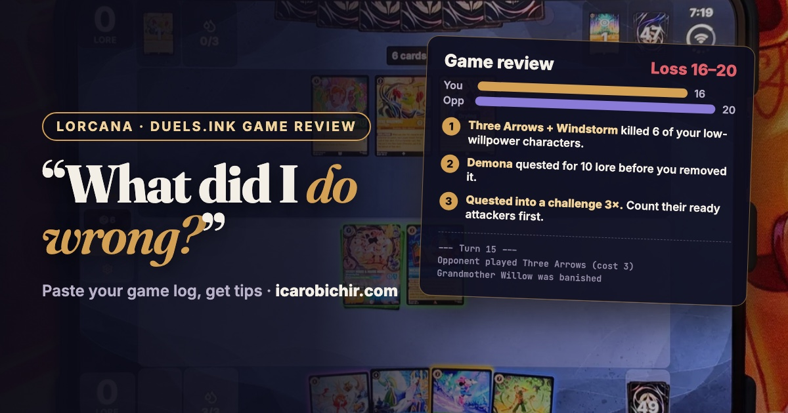

<section id="table-of-contents" class="toc">
  <header>
    <h3>Overview</h3>
  </header>
<div id="drawer" markdown="1">
*  Auto generated table of contents
{:toc}
</div>
</section><!-- /#table-of-contents -->

> **Want to try it?** `lorcana-mcp` works in Claude Desktop (one click), Claude Code, Cursor, VS Code, Windsurf, Cline, and Zed. **[Setup guide for every AI tool →](/blog/add-lorcana-mcp-to-claude-desktop/)**

<style>
.post-fig { text-align: center; margin: 1.75rem 0; }
.post-fig img { max-width: 100%; width: 100%; height: auto; border-radius: 4px; }
.post-fig figcaption { font-size: 0.85em; opacity: 0.75; margin-top: 0.5rem; }
</style>

<figure class="post-fig">
  
  <figcaption>A real review of one of my own losses.</figcaption>
</figure>

I'm playing a lot of practice games on [duels.ink](https://duels.ink) before the Disney Lorcana Challenge in Tampa next month. After a loss I used to scroll back through the game log trying to find the turn it went wrong. Then I'd write notes by hand into a file for each deck.

[v2.7.0](https://github.com/IcaroBichir/lorcana-mcp/releases/tag/v2.7.0) does that part for me. Paste the log into Claude, and the new `analyze_game_log` tool replays the game and tells you where it was won or lost.

---

### How to use it

After a match on duels.ink, open the game log panel, select all of it, and copy. Then paste it into Claude:

> *"Here's my duels.ink log. What did I do wrong? I was on my Toy Tribal deck."*

That's it. Two details made this easier than I expected:

- **It doesn't matter how the copy comes out.** Sometimes the log pastes one event per line. Sometimes every line break gets lost and the whole game arrives as one very long line. The tool splits it back into events either way.
- **Undos are handled.** duels.ink lets you take back a misclick, and the log keeps both the mistake and the redo. The tool rolls back the undone steps before it counts anything.

"You" in the log is you, so the tool always knows which side is yours.

---

### What it tracks

The log shows everything both players could see, so the tool replays it event by event:

- **Lore for both sides,** including lore that doesn't come from questing (locations, "gain 1 lore" abilities).
- **Ink:** what you inked each turn, how much ink you had, and how much you spent.
- **Your hand.** Your own draws are in the log, along with the mulligan, tutors, and cards returned to hand. So it knows what you were holding at the end of each turn.
- **Both boards, and every banish with its cause:** a challenge, or an effect like a damage action.

The opponent's hand stays hidden. Everything it says about them comes from cards they actually played, inked, or discarded.

---

### What you get back

**A turn table.** One row per turn: what you inked, what you played (ink paid versus ink available), songs, quests, and the lore score after the turn.

**The opponent.** Their inks, every card you saw, and the closest match among the tournament decklists bundled with `get_meta`. It only matches lists in the same two inks, so an Amethyst/Steel deck never gets labeled "Madrigal" because it shared a few Amethyst cards.

**Key moments.** Turns where you lost two or more characters at once, and the opponent's best questers, with when (or whether) each one was removed.

**Tips.** This is the part I actually wanted. From that loss:

```
1. Played into their damage removal. 6 of your characters died to damage
   actions: Three Arrows (4), Windstorm (2). Low-willpower bodies were the
   targets.
2. Board collapsed to challenges on turn 13. The opponent challenged and
   banished 3 of your characters in one turn.
3. Quested into a challenge 3×. T12 Woody - Jungle Guide (+2 lore →
   killed by Judy Hopps - Snowball Patrol) ...
4. Demona - Scourge of the Wyvern Clan quested for 10 lore before you
   removed it (turn 22).
```

All four are true, and I hadn't noticed the Demona one. I had two Piercing Attacks in hand for several turns and spent them on turn 22, after Demona had already made 10 of their 20 lore.

The full list of checks:

- deaths to damage actions (sweepers you played into)
- losing several characters to challenges in one turn
- questing with a character that got challenged and banished the next turn
- opposing questers removed late, or never
- missed ink drops, counted only when you were under 5 ink or holding a card you couldn't afford yet
- unspent ink while holding a card you could have played (never on the turn you won)
- inking your last copy of a card while holding two of something else
- challenges you lost without banishing the target
- slow starts

---

### Tell it your deck

Without a deck list, the tips only use what's in the log. Add your list (or a file containing it) and it also checks the game against the deck:

- **Low-count payoffs you inked.** In a win, it flagged that I'd inked my only Gaston - Superior Archer.
- **3–4-ofs that never showed up.**
- **Cards in the log that aren't in the list,** in case you pasted the wrong deck.

I keep notes for each deck in Markdown, and some files have several lists in them: the current one, a budget version, an old retired one. The tool takes the current import list and skips anything whose heading says retired, archived, or budget.

If Claude doesn't know which deck you were on, the tool's instructions tell it to ask you.

---

### What it can't see

- **The opponent's hand.** Only revealed cards count.
- **Some ink spending.** duels.ink doesn't log ink paid for activated abilities or ink drops, so the ink math counts card costs only.

The tips are heuristics. Read them as things to check, not verdicts.

---

### Also in v2.7.0

**The November ban list.** On November 3, Ravensburger banned **My Adventure Book** in Core Constructed and **Bend to My Will** in the Format Coconut beta. **Hiram Flaversham - Toymaker** stays banned in Infinity. Deck building, legality checks, and card lookups all respect the list now. Format Coconut needed this most: no outside data source tracks Coconut legality, so before this the tool counted every card as legal there.

**A Hyperia City meta snapshot.** `get_meta` was still showing the meta from September. It now has eight lists from [@onemorelore.au](https://www.instagram.com/onemorelore.au/)'s weekly "Meta Decks" roundup, one per archetype. It also has the lists from a local tournament won by a Mickey & Minnie deck. The tier list is rebuilt from post-Set-14 results:

- Emerald/Steel Evasive is still at the top.
- Amber/Emerald Circle of Life and Amber/Sapphire Detectives are right behind it.
- Emerald/Sapphire Mickey & Minnie and an Emerald/Ruby discard deck built around Olaf and The Leviathan are new contenders.

**Format Coconut cards.** `lookup_card` can now look up Coconut cards directly. The beta pool has grown to 30 cards, and at least one of them has changed its text since I last checked.

---

### Try it

```
pip install -U lorcana-mcp
```

Restart your MCP client, play a game on duels.ink, and paste the log.

- [v2.7.0 release](https://github.com/IcaroBichir/lorcana-mcp/releases/tag/v2.7.0) · [PyPI](https://pypi.org/project/lorcana-mcp/) · [MCP Registry](https://registry.modelcontextprotocol.io/?q=lorcana)
- Setup for Claude Desktop: [Add lorcana-mcp to Claude Desktop](/blog/add-lorcana-mcp-to-claude-desktop/)
- Earlier: [Part 10 — "Here's My Prerelease Pool"](/blog/lorcana-mcp-part-10-my-prerelease-pool/) · [Part 1 — Why I Built It](/blog/lorcana-mcp-part-1-why-i-built-it/)
